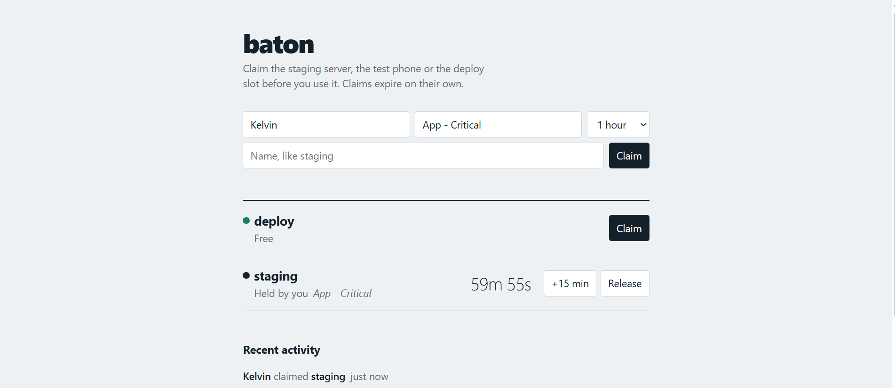

# baton

A lock board for things a team shares, like the staging server or a test phone. You claim one for a set time, everyone can see who has it, and it frees itself when the time runs out. Scripts can claim and release through the same API, so a deploy job can't run over someone who is in the middle of testing.



## Run

On Linux or Mac:

```
python -m venv .venv
source .venv/bin/activate
pip install -r requirements.txt
uvicorn main:app
```

On Windows, in PowerShell:

```
py -m venv .venv
.\.venv\Scripts\Activate.ps1
pip install -r requirements.txt
uvicorn main:app
```

Open http://localhost:8000. Data is stored in baton.db in the folder you start it from. Set BATON_DB to use a different file.

## API

```
GET  /api/resources
GET  /api/events
POST /api/resources/{name}/claim     holder, minutes, note
POST /api/resources/{name}/extend    holder, minutes
POST /api/resources/{name}/release   holder, force
```

A lock is created the first time someone claims it. Names use lowercase letters, digits and underscores. Minutes can be 1 to 480. Claiming a lock someone else holds returns 409 with the holder and the seconds left. Claiming your own lock renews it, so a retried job is safe.

## Using it from CI

```yaml
- name: Take the staging lock
  run: |
    curl -fsS -X POST "$BATON_URL/api/resources/staging/claim" \
      -H "Content-Type: application/json" \
      -d '{"holder": "ci_${{ github.run_id }}", "minutes": 20, "note": "deploy ${{ github.sha }}"}'

- name: Deploy
  run: ./deploy.sh

- name: Give the lock back
  if: always()
  run: |
    curl -fsS -X POST "$BATON_URL/api/resources/staging/release" \
      -H "Content-Type: application/json" \
      -d '{"holder": "ci_${{ github.run_id }}"}'
```

The `-f` flag makes curl fail on a 409, which stops the job before it deploys.

## Notes

There are no accounts. The holder is whatever name the caller sends, so this suits a team that trusts each other. It runs as one process on one SQLite file.

## Tests

```
pip install pytest httpx
pytest
```

## License

MIT, see LICENSE.
